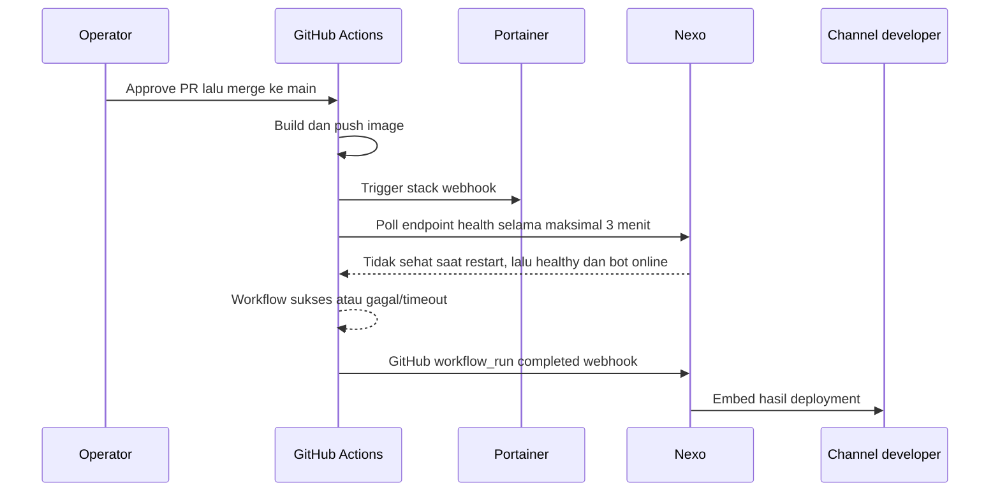

# Deployment Nexo melalui GitHub dan Portainer

> Catatan pengembangan internal, bukan dokumentasi publik. Workflow dan
> notifikasi hasil deploy sudah diterapkan sebagian; langkah validasi di bawah
> perlu diselesaikan sebelum mengandalkan alur ini untuk rilis production.

## Alur

GitHub Actions menjadi pemicu Portainer setelah merge ke `main`. Nexo tidak
memicu Portainer untuk workflow deploy Nexo, sehingga deploy tidak berjalan dua
kali. Hasil workflow selalu dikirim ke channel project yang ditentukan melalui
`discord_channel_id` di `config/projects.json`. Jika deployment berhasil, embed
yang sama juga dikirim ke devlogs. Jika gagal atau dibatalkan, embed hanya masuk
ke channel project agar devlogs tidak penuh dengan error pipeline.

Workflow hanya menganggap hasil sukses jika health endpoint Nexo sempat tidak
sehat setelah trigger, lalu kembali memberi `status: healthy` dan `bot_online`
bernilai `true`. Jika restart tidak terlihat atau health check tak pulih dalam
180 detik, workflow berakhir gagal dan Nexo mengumumkan kegagalan pipeline. Ini
menghindari anggapan sehat dari container lama yang masih menjawab.

## Human In The Loop

HITL dilakukan pada Pull Request. CI berjalan saat PR dibuat/diperbarui. Reviewer
meninjau perubahan dan memberi approval; setelah PR di-merge ke `main`, event
`push` menjalankan build dan deployment. Approval PR sendiri tidak memicu deploy
karena kode yang disetujui belum tentu sudah masuk ke branch production.

Sebelum merge, reviewer memeriksa:

1. Diff dan hasil CI.
2. Commit yang akan masuk ke `main`.
3. Bahwa branch protection meminta approval PR dan CI lulus.

Setelah merge, operator memeriksa run deployment dan hasil health check.

Atur aturan branch `main` melalui **Settings → Branches** atau **Settings →
Rules → Rulesets**:

1. Wajibkan Pull Request sebelum merge.
2. Wajibkan minimal satu approval.
3. Wajibkan status check workflow **CI (Lint & Format)** lulus.
4. Hindari bypass aturan untuk push langsung ke `main`, kecuali akun break-glass
   yang memang dibutuhkan.

## GitHub Actions Secrets

Secret berikut perlu tersedia pada repository Nexo. Organization secret yang
dibatasi ke satu repository publik Nexo dapat digunakan; repository harus
tercantum pada akses secret tersebut.

| Nama | Isi | Catatan |
| --- | --- | --- |
| `PORTAINER_NEXO_WEBHOOK_URL` | URL stack webhook Portainer yang baru | Bearer secret; jangan dicetak ke log atau disimpan ke Git. |
| `NEXO_HEALTH_URL` | URL health check publik Nexo, misalnya `https://<domain>/nexo/health` | Saat ini workflow membacanya sebagai secret. URL ini bukan credential; dapat dipindah ke Actions Variable jika workflow juga diubah menjadi membaca `vars.NEXO_HEALTH_URL`. |
| `DOCKER_USERNAME` | Username Docker Hub | Sudah digunakan workflow build. |
| `DOCKER_RELEASE` | Docker Hub access token dengan izin push ke image Nexo | Sudah digunakan workflow build. |

Workflow merge-to-main memberi tag `latest` dan tag commit SHA pada image.
Workflow ini tidak lagi membuat tag Docker dari GitHub Release; rilis GitHub
tetap dikelola oleh workflow semantic-release.

Gateway FastAPI membatasi body webhook dengan `GITHUB_WEBHOOK_MAX_BODY_BYTES`,
default `5242880` (5 MiB). Batas dapat diubah di runtime Nexo jika payload sah
secara rutin melampaui nilai itu. Batas ini berlaku sebelum body masuk ke buffer
utuh; request yang lebih besar ditolak dengan HTTP 413.

Tidak diperlukan API key Portainer untuk pola health check sederhana ini. URL
webhook digunakan untuk trigger; health check memastikan aplikasi kembali siap.

## Setting Portainer

Pada stack Git Nexo:

- **Create a Webhook:** aktif.
- **Re-pull image:** aktif, agar image baru dengan tag `latest` ditarik.
- **Force redeployment:** aktif jika Git repository adalah sumber kebenaran dan
  image bisa berubah tanpa perubahan Compose. Opsi ini dapat menimpa perubahan
  lokal pada stack.
- **Relative path volumes:** mati kecuali Compose benar-benar menggunakan
  volume relatif yang sumbernya berada di repository Git.
- Pilih registry Docker Hub yang berisi image Nexo. Batasi access control stack
  ke operator yang perlu mengelolanya.

Tidak ada environment variable yang perlu ditambahkan ke server Portainer.

## Rotasi webhook

URL stack webhook pernah tersimpan di `config/projects.json`. URL lama perlu
dinonaktifkan/dirotasi karena URL tersebut dapat memicu redeploy.

1. Nonaktifkan webhook lama pada pengaturan stack Portainer.
2. Buat URL webhook baru dan simpan langsung sebagai secret
   `PORTAINER_NEXO_WEBHOOK_URL`.
3. Pastikan secret dibatasi hanya untuk repository Nexo.
4. Hapus URL lama dari konfigurasi Git. Nilai pengganti tidak boleh masuk ke
   source code, log, atau dokumentasi.
5. Pastikan URL lama tidak lagi berfungsi dan URL baru tidak pernah dicetak ke
   log.

URL lama pada file konfigurasi Nexo sudah dihapus dari working tree. Rotasi
Portainer tetap diperlukan untuk membatalkan URL yang sudah pernah tersimpan di
riwayat Git.

## Langkah verifikasi operator

1. Di GitHub **Settings → Secrets and variables → Actions → Secrets**, pastikan
   kedua secret di atas dapat diakses repository Nexo. `NEXO_HEALTH_URL` saat ini
   ada sebagai secret, jadi jangan pindahkan ke Variables kecuali workflow juga
   diubah.
2. Pastikan GitHub webhook menuju Nexo mengirim event `workflow_run` dengan
   secret yang sama dengan `GITHUB_SECRET` runtime Nexo.
3. Pastikan webhook Portainer baru tersimpan pada secret repository Nexo.
4. Buat PR uji, tunggu CI, minta approval, lalu merge ke `main`.
5. Buka run Actions dan pastikan Portainer menerima trigger serta endpoint health
   menunjukkan unhealthy saat restart, kemudian healthy dengan bot online.
6. Pastikan status sukses masuk ke channel project dan devlogs; status gagal atau
   dibatalkan hanya masuk ke channel project.
7. Jika gagal, gunakan tautan run pada embed untuk melihat apakah build, trigger,
   atau health check yang gagal. Jangan membagikan log yang mengandung credential.

## Batasan

- Timeout health check adalah 180 detik dengan interval 10 detik.
- Jika Nexo tidak terlihat restart dalam polling, hasil dibuat gagal/unknown
  secara konservatif, meskipun deploy mungkin sukses. Periksa run dan status
  layanan sebelum retry agar tidak memicu dua deployment bersamaan.
- Health check membuktikan endpoint Nexo healthy dan bot online setelah restart;
  ini bukan pemeriksaan langsung status internal stack Portainer.
- GitHub harus bisa menjangkau Portainer webhook dan endpoint health Nexo melalui
  HTTPS dengan sertifikat valid.
- Notifikasi hasil mengandalkan webhook GitHub `workflow_run` ke Nexo.
- Workflow deployment berjalan pada `push` ke `main`, yang terjadi setelah PR
  di-merge. Workflow melewati commit versi otomatis `chore(release): bump to ...`
  agar satu merge tidak memicu deployment kedua.
- Workflow break-glass di `portainer-fallback.yml` hanya mengonfirmasi trigger
  diterima; ia belum menjalankan polling health check.
