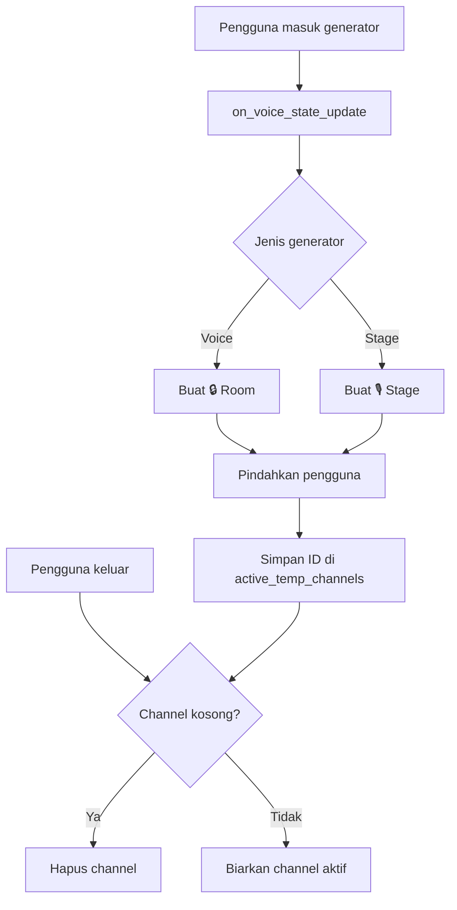

# Tools bawaan Discord

Tools lokal didaftarkan ke model sebagai function tools. Daftar yang ditampilkan oleh `$tools` dapat berubah ketika MCP Server menyediakan tools tambahan. Tools berikut adalah bawaan Nexo dari sisi Discord:

| Tool | Fungsi |
| --- | --- |
| `list_discord_events` | Menampilkan scheduled event dan event aktif di server. |
| `schedule_discord_event` | Membuat event atau meeting baru. |
| `end_discord_event` | Mengakhiri scheduled event. |
| `create_discord_thread` | Membuat thread pada channel saat ini. |
| `create_discord_poll` | Membuat native poll interaktif. |
| `end_discord_poll` | Menutup poll dan mengembalikan hasil suara. |
| `get_server_channels` | Mengambil daftar channel teks, voice, dan stage. |
| `get_server_roles` | Mengambil daftar role beserta ID. |
| `delete_channel_messages` | Menghapus pesan secara massal. |
| `list_voice_channel_members` | Menampilkan anggota dalam voice channel. |
| `search_server_members` | Mencari kandidat member berdasarkan nama tanpa mengirim mention. |
| `mention_member_in_channel` | Mengirim pesan ke satu member berdasarkan ID yang sudah dipilih. |

Nexo juga memiliki command langsung untuk sebagian fungsi tersebut, seperti `$clear`, `$voice`, `/voice`, dan `$tools`. Model menggunakan tool ketika permintaan ditulis dalam bahasa natural.

Untuk satu respons model dengan beberapa tool call, Nexo menjalankan tool yang
bersebelahan secara paralel hanya jika metadata tool menyatakan `readOnlyHint`.
Tool mutasi lokal dan tool MCP tanpa tanda read-only diproses berurutan agar
efek samping dan urutan yang diminta model tetap terjaga.

`get_server_channels` digunakan ketika pengguna meminta daftar channel server melalui mention atau `/ask`. Hasilnya berisi nama, jenis, dan ID channel yang tersedia untuk bot. Tidak ada command `$channels` atau `/channels` khusus untuk fitur ini.

`search_server_members` hanya melakukan pencarian dan mengembalikan kandidat. Tool ini tidak mengirim mention. `mention_member_in_channel` hanya digunakan saat permintaan pengguna memang meminta Nexo untuk men-tag atau memberi tahu seseorang, dan target harus berupa satu ID member yang tepat.

## Channel voice dan stage sementara

Nexo menyediakan dua generator yang dikonfigurasi melalui `GENERATOR_CHANNEL_ID` dan `GENERATOR_STAGE_ID`:

- **Generator Voice** untuk diskusi, pembelajaran, rapat kecil, dan percakapan umum.
- **Generator Stage** untuk podcast, seminar, presentasi, dan event besar.

Pengguna masuk ke salah satu generator, lalu listener `on_voice_state_update` membuat channel baru di category yang sama:

- voice biasa diberi nama `🔒 <nama pengguna>'s Room`;
- stage diberi nama `🎙 <nama pengguna>'s Stage`.

Nexo menyalin permission overwrite dari category dan memberikan pembuat channel izin mengelola channel, memindahkan anggota, dan mengatur permission. Pada stage, pembuat juga mendapat izin mute member. Setelah channel dibuat, pengguna langsung dipindahkan ke channel tersebut.

Ketika pengguna terakhir keluar dan channel menjadi kosong, Nexo menghapus channel dan mengeluarkan ID-nya dari daftar channel aktif. Saat bot menyala, Nexo memindai category yang dikonfigurasi: channel sementara yang kosong dibersihkan, sedangkan channel yang masih berisi anggota dimasukkan kembali ke cache. Karena itu channel sementara tetap dibersihkan setelah restart bot.

