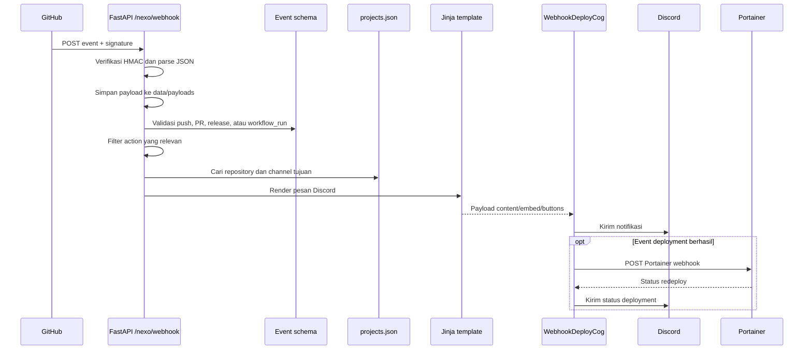

# Monitoring project melalui GitHub Webhook

Gateway FastAPI Nexo menerima webhook pada endpoint `POST /nexo/webhook`. GitHub mengirimkan nama event melalui header `X-GitHub-Event`, ID delivery melalui `X-GitHub-Delivery`, dan signature melalui `X-Hub-Signature-256`. Nexo memverifikasi signature dengan `GITHUB_SECRET` sebelum membaca payload.

Setiap payload disimpan ke `data/payloads/<event>.json` untuk analisis dan debugging. Payload untuk `push`, `pull_request`, `release`, dan `workflow_run` divalidasi dengan schema masing-masing. Event yang tidak didukung tetap disimpan dan menghasilkan notifikasi devlog.



## Event yang diproses

- `push`: diproses jika payload memiliki commit atau head commit.
- `pull_request`: diproses untuk opened, closed, reopened, synchronize, ready for review, converted to draft.
- `release`: diproses untuk released dan prereleased.
- `workflow_run`: diproses ketika action `completed` dan conclusion tersedia.
- `ping`: mengirim konfirmasi bahwa koneksi webhook berhasil.

Template memilih channel dan gaya pesan berdasarkan repository pada `config/projects.json`. Konfigurasi dapat memuat `discord_channel_id`, `discord_role_id`, judul, emoji, dan URL Portainer. Release yang sudah diterbitkan diarahkan ke channel release notes; prerelease dan event project diarahkan ke channel project atau devlog sesuai konfigurasi.

Dokumentasi memiliki lifecycle sendiri: workflow `Deploy Documentation` membangun dan menerbitkan GitHub Pages. Setelah workflow dokumentasi berhasil, Nexo hanya mengirim pengumuman dokumentasi; event ini tidak memanggil Portainer dan tidak me-redeploy container Nexo. Ini memungkinkan docs terbit tanpa menunggu deployment aplikasi.

Workflow lain yang berhasil dan namanya terlihat seperti build/push image, Docker, publish image, atau deploy dapat diklasifikasikan sebagai CD. Hanya event CD tersebut yang memanggil Portainer webhook project setelah notifikasi/status deployment diproses. Pencocokan nama dokumentasi menggunakan kata utuh seperti `docs`, `documentation`, atau `pages`, sehingga `Docker` tidak salah diklasifikasikan sebagai dokumentasi.

GitHub harus diarahkan ke URL publik aplikasi, misalnya:

```text
https://domain-anda.example/nexo/webhook
```

Aktifkan event yang diperlukan pada pengaturan webhook repository dan gunakan secret yang sama dengan `GITHUB_SECRET`. Endpoint kesehatan `GET /nexo/health` dapat dipakai untuk memeriksa apakah gateway hidup dan bot sudah online.
