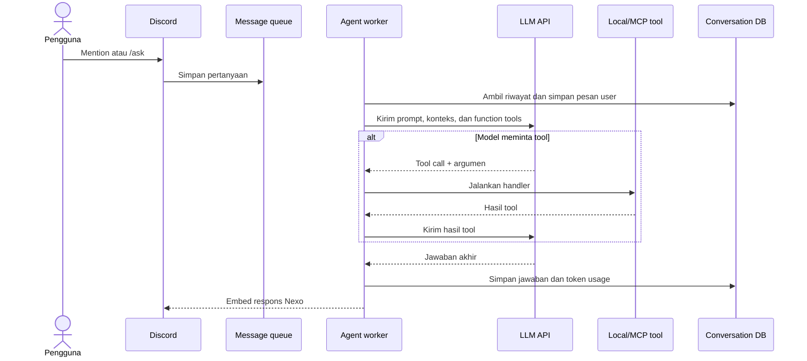

# Cara kerja chatbot LLM

Percakapan dapat dimulai dengan mention atau `/ask`. Nexo memeriksa kesehatan provider LLM, menaruh pertanyaan ke `message_queue`, lalu memberi tahu posisi antrean jika ada permintaan lain. Satu worker mengambil item antrean dan memakai lock bot agar pemrosesan berjalan teratur.

Saat worker mulai menangani satu permintaan, Nexo menghitung ulang posisi
permintaan yang tersisa dan memperbarui pesan statusnya. Edit status dijalankan
berurutan dengan jeda 1,1 detik untuk menghindari burst request ke Discord.
Untuk `/summarize`, log mencatat jumlah pesan yang diminta dan diperiksa,
perkiraan token seluruh cakupan, budget input aman, jumlah pesan utuh yang
dimasukkan, serta token aktual dari provider jika tersedia. Jika batas konteks
membatasi cakupan, respons menyebut jumlah pesan yang benar-benar diringkas.

Sebelum worker dipakai, Nexo memuat system prompt dari `prompts/system_prompt.md`, mengambil daftar tools MCP melalui SSE, menggabungkannya dengan local Discord tools, lalu membersihkan schema JSON agar ukuran konteks lebih kecil. Riwayat percakapan dibaca dari database dengan scope pasangan pengguna dan channel. Pesan dari channel atau pengguna lain tidak ikut menjadi konteks conversation tersebut.



Model memilih tool berdasarkan intent. Misalnya, pertanyaan tentang anggota voice channel dapat memanggil `list_voice_channel_members`, sedangkan permintaan membuat event dapat memanggil `schedule_discord_event`. Beberapa tool dalam satu putaran LLM dapat diminta sekaligus. Nexo mengeksekusi panggilan yang bersebelahan secara paralel hanya jika tool tersebut secara eksplisit ditandai read-only. Tool yang mengubah data dan tool MCP tanpa metadata read-only tetap dijalankan berurutan sesuai urutan panggilan model.

Jawaban ditampilkan sebagai embed Discord dengan durasi proses dan informasi token jika provider mengembalikannya. Jika LLM atau tool gagal, pengguna menerima pesan error dan kegagalan dicatat melalui logger.

## Provider LLM

`LLM_BASE_URL` harus menunjuk ke endpoint OpenAI-compatible provider, misalnya:

```env
# Azure OpenAI-compatible endpoint
LLM_BASE_URL=https://latihan-azure-1.services.ai.azure.com/openai/v1
LLM_API_KEY=your-api-key
LLM_MODEL_NAME=your-deployed-model
```

Untuk LiteLLM, `LLM_BASE_URL` dapat memakai route standar antar-container
`http://litellm-gateway:4000/v1` atau route ber-prefix seperti
`https://aiot.fik.upnvj.ac.id/gateway/v1` maupun
`https://aiot.fik.upnvj.ac.id/gateway`. Nexo meminta metadata di
`/v1/model/info?model=<LLM_MODEL_NAME>` (prefix gateway tetap dipertahankan),
memakai `model_info.max_input_tokens` untuk batas input model dan
`litellm_params.tokenizer_with_hf_repo` untuk tokenizer. `TOTAL_CONTEXT_WINDOW`
menjadi batas maksimum Nexo: metadata provider dapat menurunkan batas efektif,
tetapi tidak dapat menaikkannya. Jika metadata batas input tidak tersedia,
Nexo memakai nilai tersebut sebagai fallback.
Azure memakai base URL
`/openai/v1` dan tidak diperlakukan sebagai LiteLLM. Untuk tokenizer gated atau
private di Hugging Face, sediakan `HF_TOKEN` read-only secara terpisah dari
`LLM_API_KEY`. Jika tokenizer gagal dimuat, Nexo memakai perkiraan karakter dan
tidak mengulang unduhan gagal pada setiap pesan selama proses yang sama.
Set `HF_HUB_OFFLINE=true` jika tokenizer sudah tersedia di cache dan Nexo harus
berjalan tanpa akses jaringan ke Hugging Face.

Status provider memanggil endpoint `/models` melalui library `openai` /
`AsyncOpenAI`. Dengan begitu, pengecekan tidak perlu menghasilkan output model
dan tidak bergantung pada endpoint `/health` khusus llama.cpp.

Setelah Discord bot siap, Nexo juga mengirim satu inference warm-up dengan prompt
tetap dan batas satu token keluaran. Ini membantu provider memuat model sebelum
permintaan pengguna pertama. Warm-up berjalan sekali per proses, memakai lock
LLM agar tidak bersamaan dengan pekerjaan antrean, dan hanya mencatat jenis
error jika gagal. Request kecil ini dapat tetap dihitung sebagai penggunaan
provider. Warm-up startup tidak mencegah model dimuat ulang jika provider
melepasnya setelah idle.
